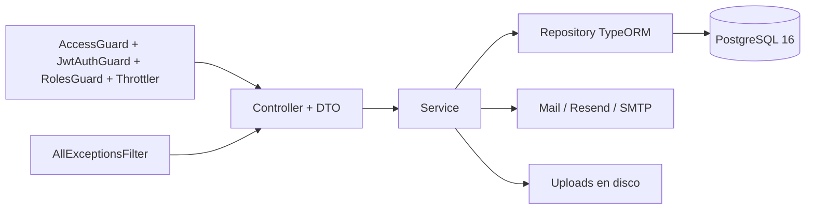

# ARCHITECTURE_CONTEXT — SIGICE Backend (`PROYECTO_GTBACKEND`, `intereses-backend`)
> Última verificación: 2026-10-28 · Commit: `70a9580` · Las reglas permanentes están en [AGENTS.md](./AGENTS.md).

1. **Resumen.** API HTTP NestJS 11 + TypeORM 0.3 sobre PostgreSQL 16 para SIGICE (Universidad del Pacífico, Buenaventura). Administra autenticación cifrada, usuarios, periodos académicos, temas, asignaturas/grupos, encuestas de intereses y de asignaturas, capacitaciones, recordatorios, métricas de dashboard y uploads. Es la fuente de verdad de datos y autorización para los tres frontends Angular (`PROYECTO_GT`, `GT2`, `GT3`). Puede servir el frontend compilado si existe `frontend/dist/app/browser` o `../frontend/dist/app/browser`; en desarrollo normal funciona solo como API.

2. **Stack verificado.**

| Tecnología | Versión | Evidencia |
|---|---|---|
| NestJS (`@nestjs/core`) | 11.2.7 | `package-lock.json` |
| TypeORM / `pg` | 0.3.31 / 8.23.1 | `package-lock.json` |
| PostgreSQL | 16 | `docker-compose.yml` |
| TypeScript | 5.9.3 | `package-lock.json` |
| Node.js | `>=20`; 22 en Docker | `package.json`, `Dockerfile` |
| Seguridad | Argon2id 0.44.0, bcryptjs legado, JWT HS256, Helmet 8.3.0 | `src/common/`, `src/modules/auth/` |
| Validación / Swagger | class-validator 0.14.4, `@nestjs/swagger` 11 | `src/main.ts`, DTOs |
| Pruebas | Jest 29.7.0 + ts-jest; 40 archivos `*.spec.ts` | `package.json`, `src/` |
| Lint / CI | No existen | raíz del repo |

3. **Mapa del repositorio.**

```text
.
├── src/
│   ├── main.ts                 # bootstrap, Helmet, CORS, Swagger, estáticos, uploads
│   ├── app.module.ts           # Config, TypeORM, throttling y guards globales
│   ├── data-source.ts          # DataSource explícito para CLI/migraciones/seed
│   ├── common/                 # guards, filtros, CORS, logging seguro, health, decoradores
│   ├── config/                 # JWT hardening y política de migraciones
│   ├── modules/                # auth, users, periodos, temas, encuestas,
│   │                           # encuestas-asignaturas, asignaturas, capacitaciones,
│   │                           # dashboard, recordatorios, mail, uploads
│   ├── migrations/             # 13 migraciones SQL versionadas
│   ├── scripts/                # reset de contraseñas
│   ├── test/                   # integración HTTP y de base de datos
│   ├── seed.ts / seed-policy.ts
│   └── migrate-guarded.ts
├── uploads/                    # imágenes; solo .gitkeep se versiona
├── Dockerfile / docker-compose.yml
├── AGENTS.md / README.md
└── .env                        # local, gitignored; nunca se documentan valores
```

4. **Arquitectura y capas.** Flujo: `main.ts` → `AppModule` → controller → service → repositorio TypeORM → PostgreSQL. No hay capa de dominio separada ni repositorios personalizados: los servicios usan `Repository` de TypeORM. Los límites reales son:

| Capa | Responsabilidad | Ejemplos | Regla |
|---|---|---|---|
| Entrada HTTP | Rutas, decoradores de acceso, DTOs | `src/modules/*/*.controller.ts` | Toda ruta declara `@Public()` o `@Auth(...)` |
| Aplicación | Reglas de negocio y transacciones | `*.service.ts` | No conoce detalles de Express salvo casos justificados |
| Persistencia | Entidades, índices, migraciones | `*.entity.ts`, `src/migrations/` | `synchronize: false`; entidades explícitas |
| Transversal | Guards, CORS, filtros, logging, salud | `src/common/`, `src/config/` | Se aplica globalmente; no contiene reglas de negocio |
| Integraciones | Correo, OAuth, disco | `modules/mail`, `auth/*strategy.ts`, `uploads` | Fallos externos no deben filtrar secretos |



5. **Convenciones y patrones (recetas reales).**

| Tarea | Receta | Ejemplo canónico |
|---|---|---|
| Módulo nuevo | `modules/<feature>/` con module, controller, service, DTOs, entidad y spec; registrar en `app.module.ts` y `data-source.ts` | `src/modules/temas/` |
| Ruta | Prefijo global `/api`; declarar `@Public()` o `@Auth('ADMIN'/'ESTUDIANTE')`; DTO con class-validator | `src/modules/periodos/periodos.controller.ts` |
| Persistencia | Entidad con nombres snake_case explícitos, índices y FK; sin `synchronize` | `src/modules/encuestas/respuesta.entity.ts` |
| Migración | Clase explícita en `src/migrations/` e importada en `data-source.ts` | `src/migrations/1700000000012-grupos-asignaturas.ts` |
| Error de negocio | `BadRequestException`, `UnauthorizedException`, `NotFoundException`; el filtro global normaliza | `src/common/all-exceptions.filter.ts` |
| Prueba | Jest junto al archivo (`*.spec.ts`); integración en `src/test/` | `src/modules/auth/auth.service.spec.ts` |
| Seed | Idempotente; valida claves en producción; no ejecuta migraciones | `src/seed.ts`, `src/seed-policy.ts` |

El código y los mensajes de usuario están en español. `tsconfig` usa `strictNullChecks: false`; no asumir tipado estricto. No hay lint ni formateador; no reformatear archivos ajenos.

6. **Datos y contratos.** Prefijo global `/api`. Respuesta de error uniforme: `{ statusCode, error, message, correlationId }`. Swagger está en `/api/docs` (se puede desactivar con `ENABLE_SWAGGER=false`); `/docs`, `/api-docs` y `/api` redirigen allí, y la raíz también cuando no se sirve el frontend. No hay cliente generado ni versionado de contrato; los frontends escriben las URLs e interfaces manualmente.

**Endpoints por módulo** (roles entre paréntesis; `P` = público).

| Módulo | Rutas principales |
|---|---|
| Auth | `GET /auth/login-crypto` (P), `POST /auth/login` (P), `GET /auth/me`, `PATCH /auth/mi-semestre`, `POST /auth/recuperar` (P), `POST /auth/restablecer` (P), `GET /auth/sso-status` (P), `GET /auth/google` y `/auth/microsoft` con callbacks (P), `POST /auth/sso/exchange` (P), `POST /auth/sso/completar` (P) |
| Usuarios | `GET/POST /usuarios`, `POST /usuarios/verificar-admin`, `PATCH/DELETE /usuarios/:id`, `PATCH /usuarios/:id/clave` (ADMIN) |
| Periodos | `GET /periodos/activo` (P); `GET/POST /periodos`, `PATCH /periodos/:id`, `POST /periodos/:id/activar`, `PATCH /periodos/:id/encuesta-asignaturas`, `DELETE /periodos/:id` (ADMIN) |
| Temas | `GET /temas` (P); `GET /temas/admin/todos`, `POST /temas`, `PATCH /temas/admin/cambiar-estado-todos`, `PATCH /temas/admin/cambiar-estado-todas` (compatibilidad), `PATCH/DELETE /temas/:id` (ADMIN) |
| Asignaturas | `GET /asignaturas`, `GET /asignaturas/:id/grupos` (ESTUDIANTE/ADMIN); `GET /asignaturas/admin/todas`, `POST/PATCH/DELETE /asignaturas`, `PATCH /asignaturas/admin/cambiar-estado-todas`, `POST /asignaturas/:id/grupos`, `PATCH/DELETE /asignaturas/grupos/:grupoId` (ADMIN) |
| Encuestas | `GET /encuestas/temas-aleatorios`, `GET /encuestas/mi-respuesta` (ESTUDIANTE/ADMIN); `POST /encuestas`, `PATCH /encuestas/mi-respuesta` (ESTUDIANTE) |
| Encuestas de asignaturas | `GET /encuestas-asignaturas/estado`, `GET /encuestas-asignaturas/mi-respuesta` (ESTUDIANTE/ADMIN); `POST /encuestas-asignaturas/inscripciones`, `POST /encuestas-asignaturas` (ESTUDIANTE) |
| Capacitaciones | `GET /capacitaciones/mias` (ESTUDIANTE); `GET /capacitaciones` (ADMIN); `GET /capacitaciones/:id` (AMBOS); `POST/PATCH/DELETE /capacitaciones` (ADMIN); `POST /capacitaciones/:id/clic` (AMBOS); `POST /capacitaciones/:id/notificar` (ADMIN) |
| Dashboard | `GET /dashboard/{top-temas,heatmap,tasa-respuesta,comparativo,declarado-vs-real,resumen,export}` (ADMIN) |
| Dashboard materias | `GET /dashboard-materias/{top-asignaturas,tasa-respuesta,heatmap,satisfaccion,comparativo,resumen,desglose-grupos}` (ADMIN) |
| Recordatorios | `GET /recordatorios/resumen`, `POST /recordatorios/ejecutar` (ADMIN) |
| Uploads | `GET /uploads/:nombre` (ESTUDIANTE/ADMIN, con autorización por recurso) |
| Salud | `GET /health` (P, sin throttle) |

**Entidades y persistencia** (17 entidades; sin carpeta `models/`):

| Entidad / tabla | Datos clave |
|---|---|
| `User` / `usuarios` | UUID, correo único, nombre, identificación, `password_hash`, `token_version`, proveedor, semestre 1–9, rol, consentimiento Ley 1581 |
| `Periodo` / `periodos` | Nombre único, fechas, activo con índice único parcial, modo de encuesta, ventana de encuesta de asignaturas |
| `Tema` / `temas` | Nombre único, descripción, activo |
| `Respuesta` + `RespuestaTema` | Una respuesta por usuario/periodo; ítems por tema con puntaje nullable |
| `Asignatura` + `GrupoAsignatura` | Semestre, activo, grupos con profesor/código/horario y FK en cascada |
| `RespuestaAsignatura` + `RespuestaAsignaturaItem` | Una respuesta por usuario/periodo; ítems con dificultad, satisfacción y grupo |
| `InscripcionAsignatura` | Única por usuario/periodo/asignatura; grupo nullable |
| `Capacitacion` + `CapacitacionSemestre` + `ClicCapacitacion` | Estado, modalidad, fechas, semestres destino, clics por usuario |
| `RecordatorioEnviado` | Control de recordatorios por usuario/periodo |
| `PasswordReset`, `SsoCode`, `LoginChallenge` | Tokens/códigos de un solo uso, hashes y expiración |

Invariantes: 1–5 temas en modo selección; puntajes 1–5; máximo 4 asignaturas con dificultad; semestre 1–9; una respuesta por usuario/periodo; un solo periodo activo; grupo obligatorio si la asignatura tiene grupos; imagen ≤ 2 MB. La base y los servicios deben seguir validando estas reglas; no confiar en el cliente.

7. **Autenticación, autorización y seguridad.**

| Control | Implementación real | Límite / riesgo |
|---|---|---|
| Contraseñas | Argon2id (19 MiB, 2 iteraciones, paralelismo 1); bcrypt legado verificable y rehash opcional | El rehash en login depende de `PASSWORD_REHASH_ON_LOGIN`; sin él, hashes legados permanecen |
| Login | `GET /auth/login-crypto` entrega RSA pública, `keyId` y challenge de 2 min; `POST /auth/login` descifra RSA-OAEP SHA-256 + AES-256-GCM con AAD | Requiere claves PKCS#8 RSA ≥ 3072 bits; challenge de un solo uso |
| Sesión | JWT HS256, `sub` + `tokenVersion`, expiración `JWT_EXPIRES_IN` (12 h por defecto) | Sin refresh token; revocación solo incrementando `tokenVersion` |
| Guards | `AccessGuard` exige decorador; `JwtAuthGuard` valida JWT; `RolesGuard` comprueba rol; `ThrottlerGuard` global 100/min | `ACCESS_POLICY_MODE=audit` relaja rutas sin decorador/rol; no usar en producción |
| Recuperación | Token aleatorio, hash SHA-256, 1 h, un solo uso; respuesta genérica exista o no el correo | Si Resend falla, el error se registra sin datos y la respuesta sigue genérica |
| SSO | Google/Microsoft opcionales; state OAuth firmado en cookie HttpOnly; código de intercambio en cookie HttpOnly de 60 s, guardado solo como hash | Requiere credenciales, `AUTH_SSO_ENABLED=true` y CORS/cookies correctos; no verificado |
| Uploads | Tipo detectado por firma binaria, nombre aleatorio, límite 2 MB; `/uploads/*` bloqueado; descarga por `/api/uploads/:nombre` con JWT y permiso por recurso | Disco local: en Railway necesita volumen persistente; no hay antivirus |
| Borde | Helmet, CORS con `FRONTEND_URL` + `localhost:4200`, `trust proxy`, `no-store` en API, `x-powered-by` desactivado | Sin rate limit distribuido; Swagger activo por defecto; cabeceras dependen del proxy |
| Datos personales | Correo, nombre, identificación, respuestas y consentimiento; logs redactados | Aplica Ley 1581; no registrar cuerpos ni PII |

8. **Errores, validación y logging.** `ValidationPipe` global con whitelist y transformación; DTOs con class-validator. `AllExceptionsFilter` normaliza todo a `{ statusCode, error, message, correlationId }`, registra 5xx con stack redactado, 401 como warning y 403 con modo/rol sin PII. `correlation-id.middleware.ts` acepta/propaga `X-Correlation-Id`. `log-seguro.ts` evita volcar cuerpos sensibles. No hay logger estructurado externo ni métricas/tracing; los logs van a stdout/stderr. No registrar contraseñas, tokens, sobres, correos, identificaciones ni respuestas.

9. **Pruebas y calidad.** Jest con `rootDir: src`, `*.spec.ts` y `ts-jest`; hay 40 specs, incluidas unitarias de auth, acceso, reglas, DTOs y servicios, más integración HTTP/DB en `src/test/`. La integración crea el esquema con `synchronize()` en `intereses_db_test` y trunca datos; `TEST_DB_NAME` debe terminar en `_test`. No hay lint, formato, cobertura obligatoria ni CI. El 2026-10-28 se ejecutaron build y pruebas: **build OK**; unitarias **333/345** (12 fallos, 6 suites rojas); integración real **22/24** (2 fallos). Fallos deterministas: `railway.json`/`migrate:prod` ausentes, specs que leen `karol1/frontend/src` inexistente, constructor de asignaturas desactualizado, expectativas de `grupos` y `semestreAlResponder` desalineadas. Cobertura no generó resumen por suites rojas. Detalle en [`TEST_REPORT.md`](../TEST_REPORT.md).

10. **Comandos y entorno.** La fuente de verdad es [`AGENTS.md`](./AGENTS.md) → `Commands`. Resumen: `npm ci`; `npm run start:dev`; `npm run build` + `npm run start:prod`; `npm test`; `docker compose up -d postgres`; `npm run seed`; migraciones con `migration:generate`, `migration:run` y en producción `migration:run:guarded` + `MIGRATE_CONFIRM=YES`.

| Grupo | Variables (sin valores) |
|---|---|
| Base de datos | `DB_HOST`, `DB_PORT`, `DB_USER`, `DB_PASSWORD`, `DB_NAME`, `DB_MIGRATIONS_RUN` |
| Seguridad / sesión | `JWT_SECRET`, `JWT_EXPIRES_IN`, `LOGIN_CRYPTO_ACTIVE_KEY_ID`, `LOGIN_CRYPTO_KEYS_JSON`, `ACCESS_POLICY_MODE`, `TRUST_PROXY` |
| Aplicación | `NODE_ENV`, `PORT`, `FRONTEND_URL`, `UPLOADS_DIR`, `ENABLE_SWAGGER`, `ALLOWED_EMAIL_DOMAIN`, `PASSWORD_REHASH_ON_LOGIN` |
| SSO | `AUTH_SSO_ENABLED`, `GOOGLE_CLIENT_ID`, `GOOGLE_CLIENT_SECRET`, `GOOGLE_CALLBACK_URL`, `MICROSOFT_CLIENT_ID`, `MICROSOFT_CLIENT_SECRET`, `MICROSOFT_CALLBACK_URL`, `MICROSOFT_TENANT` |
| Correo | `RESEND_API_KEY`, `RESEND_FROM`, `MAIL_FROM`; alternativa `SMTP_HOST`, `SMTP_PORT`, `SMTP_USER`, `SMTP_PASSWORD` |
| Seed / operación | `ADMIN_EMAIL`, `ADMIN_NOMBRE`, `ADMIN_PASSWORD`, `ESTUDIANTE_*`, `SEED_DEMO_STUDENT`, `MIGRATE_CONFIRM`, `RESET_PASSWORDS_CONFIRM`, `TEST_DB_NAME` |

El arranque falla si `JWT_SECRET` mide menos de 32 caracteres o es un valor de ejemplo, o si las claves de login no son RSA PKCS#8 de al menos 3072 bits. `ConfigModule` busca `../.env` y luego `.env`; no hay `.env.example`. No se documentan ni copian valores reales.

11. **Despliegue.** `Dockerfile` multi-stage Node 22: `npm ci`, build, luego runtime con dependencias de producción y `node dist/main`. `docker-compose.yml` levanta PostgreSQL 16 con healthcheck y el backend, con volúmenes `pgdata` y `uploads`. En producción `migrationsRun` está desactivado; el runner protegido exige `MIGRATE_CONFIRM=YES`. No hay `railway.json`, pipeline, health check de imagen ni backups automatizados en este repo; los tests de política de migraciones/seed fallan por ese archivo ausente y por el script `migrate:prod`. Railway y la ejecución real quedan **No verificado**. Orden: migraciones → backend → frontend. Para revertir, desplegar la imagen anterior y aplicar el plan de datos correspondiente.

12. **Relación con otros repos.**

| Repo | Rol | Contrato |
|---|---|---|
| `PROYECTO_GT` | Frontend base | Consume esta API; dashboard sin Top 5/mapa de calor y grupos sin edición inline |
| `PROYECTO_GT2` | Frontend variante | Consume además `/dashboard-materias/heatmap` y `PATCH /asignaturas/grupos/:id` |
| `PROYECTO_GT3` | Frontend variante equivalente a GT2 | Mismo contrato que GT2 |
| `PROYECTO_GTBACKEND` (este repo) | API y persistencia | Fuente de verdad |

Cambios que exigen coordinación: DTOs/rutas, envelope de login (`version:1`, RSA-OAEP/SHA-256, AES-GCM y AAD), roles/claims, formato de `imagenUrl` y descarga de uploads, respuestas del dashboard y orígenes/cookies SSO. No hay cliente generado ni versionado de contrato.

13. **Deuda conocida y zonas frágiles.**

| Severidad | Hallazgo | Evidencia | Impacto | Acción recomendada |
|---|---|---|---|---|
| Alta | Specs de migración/seed fallan porque `railway.json` y `migrate:prod` no existen en esta copia | `src/config/migration-policy.spec.ts`, `src/seed-policy.spec.ts`, `package.json`, `TEST_REPORT.md` | Suite roja y despliegue no reproducible | Alinear specs/scripts o añadir configuración versionada con aprobación |
| Alta | Sin CI, lint ni formato; solo build/Jest manuales | raíz | Regresiones y estilo inconsistentes | Añadir pipeline y lint tras aprobar stack |
| Alta | Uploads en disco local sin política de respaldo/volumen documentada | `uploads/`, `Dockerfile` | Pérdida de imágenes al recrear el contenedor | Volumen persistente, backup y verificación de restauración |
| Alta | Migraciones productivas dependen de un runner externo no versionado; sin plan de rollback documentado | `migrate-guarded.ts`, `railway.json` ausente | Despliegue/rollback frágil | Versionar configuración y documentar rollback y backup |
| Media | `strictNullChecks: false` y specs excluidos del build | `tsconfig.json` | Errores de nulabilidad no detectados | Evaluar migración gradual con pruebas |
| Media | Docker corre como root y no declara `HEALTHCHECK` | `Dockerfile` | Mayor superficie y salud no verificable por contenedor | Usuario no root y health check |
| Media | Swagger habilitado por defecto, incluso en producción | `src/main.ts` | Expone superficie de API | Desactivar por entorno si no se requiere |
| Media | `ACCESS_POLICY_MODE=audit` permite rutas sin decorador/rol | `src/common/access-policy.service.ts` | Riesgo si se configura mal en producción | Mantener `enforce` y validar en arranque |
| Media | Sin refresh token; revocación solo por `tokenVersion` | `src/modules/auth/` | Sesiones de 12 h sin rotación | Evaluar rotación/refresh si el riesgo lo exige |
| Media | Correo en simulación si faltan credenciales; recuperación no avisa al usuario | `ResendService`, `MailService` | Recuperación silenciosamente no enviada | Alerta operativa y prueba de correo |
| Media | Sin backups/restauración automatizados de PostgreSQL | `docker-compose.yml`, raíz | Pérdida de datos | Definir RPO/RTO y probar `pg_dump`/restore |
| Baja | `temas` mantiene dos rutas de cambio masivo (`todos`/`todas`) por compatibilidad | `temas.controller.ts` | API confusa | Deprecar una con aviso |
| Baja | No hay `.env.example`; variables requeridas dispersas en código | raíz | Configuración propensa a error | Añadir ejemplo sin secretos |
| Baja | Sin métricas, tracing ni alertas; logs solo a stdout | `src/common/` | Diagnóstico limitado | Integrar observabilidad si el despliegue lo permite |

Brechas de skills: hay skills de backend, bases de datos, seguridad, pruebas, DevOps, redes, frontend, arquitectura y analítica; no hay una específica de NestJS 11/TypeORM 0.3. Las decisiones se validan contra el código y este documento. Las skills no sustituyen la ejecución real de pruebas.

14. **Qué NO hacer.** No usar `synchronize` ni tocar el esquema a mano en producción. No ejecutar `migration:run` contra producción sin `migration:run:guarded` y `MIGRATE_CONFIRM=YES`. No añadir entidades sin registrarlas en `app.module.ts` y `data-source.ts`. No crear rutas sin `@Public()`/`@Auth`. No debilitar Argon2id, JWT, guards, CORS, validación ni límites de subida. No registrar `.env`, tokens, contraseñas, sobres de login, correos, identificaciones ni respuestas. No commitear `uploads/`, `dist/`, `node_modules/`, `coverage/` ni `.env`. No exponer `/uploads/*` sin JWT ni cambiar contratos sin coordinar los frontends.

15. **Reglas permanentes heredadas de `AGENTS.md`.**

| Regla | Origen (línea o sección) | Estado |
|---|---|---|
| API NestJS 11 + PostgreSQL 16 + TypeORM; código y mensajes en español | Línea 3 | Vigente |
| `npm ci`, `start:dev`, build/start:prod, Jest, Compose, seed y migraciones | `Commands`, líneas 7-14 | Vigente |
| `.env` fuera de Git; no registrar DB/JWT/SSO/SMTP/login-crypto | `Config and startup`, línea 18 | Vigente |
| `JWT_SECRET` ≥ 32 y claves RSA PKCS#8 ≥ 3072 bits obligatorias | Línea 19 | Vigente |
| Prefijo `api`, Helmet, CORS, Swagger y `/api/health` | Línea 20 | Vigente |
| Migraciones automáticas desactivadas en producción | Línea 22 | Vigente |
| Toda ruta debe declarar `@Public()` o `@Auth(...)` | Línea 26 | Vigente |
| Login cifrado con challenge de un solo uso y 2 minutos | Línea 27 | Vigente |
| Argon2id, bcrypt legado y rehash; nunca loguear cuerpos | Línea 28 | Vigente |
| Uploads por firma binaria y descarga con JWT/permiso | Línea 29 | Vigente |
| Servir frontend compilado si existe; si no, solo API | Línea 30 | Vigente |
| `synchronize: false`; entidades explícitas en dos archivos | Línea 34 | Vigente |
| Migraciones explícitas e importadas en `data-source.ts` | Línea 35 | Vigente |
| Integración solo contra base `_test` | Línea 36 | Vigente |
| Estructura `common`, `config`, `modules`, `migrations`, `test` | `Structure` | Vigente |
| Runner protegido y `MIGRATE_CONFIRM=YES` | Línea 47 | Vigente |
| `strictNullChecks: false`; specs fuera del build | Línea 48 | Vigente |
| `.gitignore` cubre dependencias, build, `.env`, cobertura y uploads | Línea 49 | Vigente |
| Sin lint/format; build y Jest son la verificación | Línea 50 | Vigente |
| `DB_HOST=postgres` en Compose y `localhost` en host | Línea 51 | Vigente |

16. **Skills aplicables.**

| Skill | Cuándo cargarla | Regla clave | Brecha actual |
|---|---|---|---|
| `backend` | API, módulos, auth, validación | Contratos explícitos y mínimo privilegio | Sin lint/CI |
| `database-engineering` | Entidades, consultas, migraciones | Integridad, migraciones seguras y medición | Sin backups ni planes verificados |
| `software-architecture` | Límites y refactors | Cambios incrementales | Servicios grandes sin pruebas de caracterización |
| `cybersecurity` | Auth, uploads, CORS, PII | Validación en servidor y no secretos | Sin auditoría ni escaneo de dependencias |
| `testing-quality` | Cambios de comportamiento | Caracterización y casos negativos | Spec desalineada; sin CI |
| `devops-cloud` | Docker, Railway, operación | Configuración por entorno y salud | Sin `railway.json` ni health check |
| `network-engineering` | CORS, proxies, SSO | Orígenes explícitos y cookies seguras | SSO/CORS reales **No verificado** |
| `frontend` | Contratos que afectan a los SPAs | No romper el consumo existente | Tres consumidores con deriva |
| `data-analytics` | Dashboard y métricas | Agregaciones trazables | Definiciones no documentadas |

17. **Regla de continuidad (OBLIGATORIA PARA TODO AGENTE).**

"Todo agente que trabaje en este repositorio debe:
1. Leer `AGENTS.md` completo antes de empezar.
2. Cargar las skills aplicables listadas en la sección 16 (si están disponibles en su entorno) y leer este archivo completo antes de empezar, contrastándolo con el código de las zonas que vaya a tocar.
3. Seguir la MISMA arquitectura, capas, convenciones y patrones aquí descritos, y los estándares de las skills. No introducir estructuras, librerías, estilos ni patrones nuevos sin justificarlo y sin aprobación del usuario.
4. Reutilizar los componentes, servicios y utilidades existentes antes de crear nuevos.
5. Si una tarea exige romper o cambiar la arquitectura, o si una skill y este documento se contradicen, detenerse y consultar al usuario.
6. Al terminar cada tarea, registrar lo que hizo en `AGENT_CHANGELOG.md` y, si cambió algo descrito aquí (estructura, endpoints, patrones, comandos, variables, contratos), actualizar la sección correspondiente en el mismo commit.
7. Si cambia un contrato compartido con otro repo, anotarlo en la sección 12 y en el registro, indicando qué repo debe ajustarse.
8. Marcar como 'No verificado' lo que no pudo comprobar. Nunca afirmar pruebas pasadas que no ejecutó."

18. **Referencias.** Reglas permanentes: [`AGENTS.md`](./AGENTS.md) · `package.json` · `package-lock.json` · `src/main.ts` · `src/app.module.ts` · `src/data-source.ts` · `src/common/` · `src/config/` · `src/modules/` · `src/migrations/` · `src/test/` · `docker-compose.yml` · `Dockerfile` · `AGENT_CHANGELOG.md`. Existe `README.md` mínimo; **no existen** `PROJECT_CONTEXT.md`, `ARCHITECTURE.md`, `TECH_STACK.md`, `.env.example` ni `railway.json` (verificado por listado).
